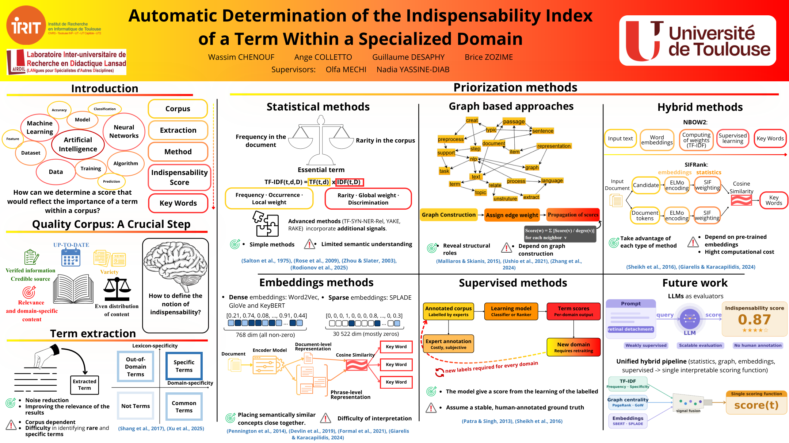

# Domain Term Ranking

**Keyword Extraction and Importance Ranking in Specialized Domains**

An academic NLP project exploring how to identify and rank important terms in domain-specific scientific texts. Developed in the context of **CheckYourSmile**, a collaborative educational platform project, this repository presents my experimental work with three approaches to **unsupervised keyphrase extraction and ranking**: **Hybrid2**, **SIFRank / SIFRank+**, and **SPLADE-v3**.

The goal is to explore different signals of term importance—including statistical features, graph-based ranking, contextual embeddings, and sparse lexical representations—not to claim a definitive measure of a term's indispensability. The original experiments produced ranked keyphrases and visualizations; they did **not** establish a ground-truth-based accuracy benchmark across the three approaches.

## Methods

| Method | Main approach | What is implemented | Notebook |
|---|---|---|---|
| **Hybrid2** | Statistical + graph-based fusion | Combines **TopicRank**, **YAKE**, and **RAKE** rankings by normalizing and fusing keyphrase scores | [Hybrid2](notebooks/hybrid2.ipynb) |
| **SIFRank / SIFRank+** | Contextual embeddings + statistical weighting | Uses **ELMo**, **Smooth Inverse Frequency (SIF)** weighting, candidate extraction, and document–candidate similarity; SIFRank+ adds a position-based adjustment | [SIFRank](notebooks/sifrank.ipynb) |
| **SPLADE-v3** | Learned sparse representations | Uses SPLADE term weights, spaCy noun-phrase candidates, and phrase reranking in an **ERU-KG-inspired** pipeline | [SPLADE](notebooks/splade.ipynb) |

Each notebook contains its methodological explanation, references to the relevant publications, implementation notes, and options for a built-in example corpus or external text data. The SPLADE notebook is **not** a full reproduction of ERU-KG; see its implementation notes for the supported components and omissions.

## Experimental corpora

The original research used English-language scientific-text collections, with **one document per nonempty line** (typically a paper title followed by its abstract):

| File used in the experiments | Domain | Documents | Notes |
|---|---|---:|---|
| `ml_en.txt` | Machine learning | 50,000 | Larger collection of scientific texts |
| `ml_en_junior.txt` | Machine learning | 500 | First 500 entries of `ml_en.txt` |
| `oral_surgery_en.txt` | Oral surgery | 594 | Scientific texts from a second specialized domain |

**These original TXT corpora are not included in the repository.** Their exact retrieval sources are not documented here; the collections were assembled as part of the wider collaborative project. Both domains were used to explore the sensitivity of term rankings to specialized vocabulary. The original result folders retain their historical labels (`corpus checkyoursmile` and `nouveau corpus`), rather than asserting an unverified one-to-one mapping to these three files.

For a small, self-contained demonstration, each notebook defines its own illustrative example corpus, which is **separate from the original experimental data**.

## Repository structure

```text
DomainTermRanking/
├── notebooks/
│   ├── hybrid2.ipynb
│   ├── sifrank.ipynb
│   └── splade.ipynb
├── results/
│   ├── hybrid2/
│   ├── sifrank/
│   └── splade/
├── docs/
│   ├── article.pdf
│   └── poster.pdf
├── .gitignore
└── README.md
```

The `results/` directory preserves the original figures and, for SIFRank, CSV ranking outputs. The research documents are available under `docs/`.

## Running the notebooks

The notebooks are **independent research artifacts**, not a unified Python package. Open an individual notebook in Jupyter or a compatible notebook environment and follow its setup cells. **Use separate environments** when appropriate, especially for SIFRank's legacy dependencies.

1. Start with the notebook's **Dependencies / Environment** section and install its required packages and external assets.
2. Leave the default example-corpus setting enabled for a demonstration. For your own data, save a UTF-8 `.txt` file with **one document per line** in a local directory, for example `data/my_corpus.txt`.
3. Change the notebook's corpus configuration and run the cells in order. `data/` is ignored by Git, so local datasets are not committed accidentally.

For **Hybrid2** and **SPLADE**, use:

```python
from pathlib import Path

CORPUS_SOURCE = 'file'  # use 'example' for the built-in demonstration
CORPUS_PATH = Path('../data/my_corpus.txt')
```

For **SIFRank**, which can load multiple named domains, use:

```python
from pathlib import Path

CORPUS_SOURCE = 'files'  # use 'example' for the built-in demonstration
CORPORA = {'my_domain': Path('../data/my_corpus.txt')}
```

Paths are resolved relative to the **Jupyter kernel's working directory**. The example paths assume the working directory is `notebooks/`; adjust them if you start Jupyter from the repository root or another location.

### Dependencies and environment notes

| Notebook | Main dependencies | Additional setup |
|---|---|---|
| **Hybrid2** | `pke`, `yake`, `rake-nltk`, `nltk`, `spacy` | spaCy language models and NLTK resources are downloaded by the setup cell; GPU not required |
| **SIFRank** | Original environment: **Python 3.6.13**, **AllenNLP 0.8.4**, PyTorch, NumPy, scikit-learn, pandas, NLTK, spaCy | Requires external **ELMo model files**, **Stanford CoreNLP 3.9.2**, and Java (originally Java 8); paths must be configured in the notebook |
| **SPLADE** | `sentence-transformers` (including `SparseEncoder`), `huggingface_hub`, `spacy`, `numpy`, `pandas`, `matplotlib`, `tqdm` | Downloads [`naver/splade-v3`](https://huggingface.co/naver/splade-v3); follow the notebook's authentication guidance if needed |

Dependency versions are not completely pinned for Hybrid2 or SPLADE. SIFRank uses a historical software stack that may be difficult to reproduce on modern systems. **The revised notebooks have been checked for structure and syntax but have not been fully re-executed end to end in a clean environment.** The saved experimental results come from the original project work, not from a new verified execution of the revised notebooks.

## Experimental results and observations

The experiments produced **keyphrase rankings and associated scores** for specialized scientific corpora. All original figures and CSV outputs are preserved in [`results/`](results/), including intermediate rankings and configurations that produced less informative terms. The observations below are **qualitative**, based on inspection of the saved outputs; they are not measurements of precision, recall, or F1-score.

### Hybrid2 — score saturation and redundancy

The fusion of TopicRank, YAKE, and RAKE yielded rankings that were not consistently discriminative. In particular, one unnormalized output assigned the same score (**9**) to many entries, limiting its usefulness for ordering terms. The normalized results still contained multiple closely related or redundant keyphrases. This illustrates the difficulty of combining heterogeneous scoring schemes: normalization and score fusion alone do not guarantee diverse, meaningful domain terms.

[View original Hybrid2 results](results/hybrid2/) · [Open Hybrid2 notebook](notebooks/hybrid2.ipynb)

### SIFRank — more interpretable candidates in the inspected outputs

Among the saved examples, SIFRank produced some of the more interpretable domain-related expressions. The results include **ELMo visualizations** and structured CSV rankings for **BERT and SBERT**, with both **SIFRank** and **SIFRank+** variants. The figure below is an original output, retained as generated during the experiments; it is an illustration of extracted terms rather than an accuracy chart.


[View all SIFRank results and CSVs](results/sifrank/) · [Open SIFRank notebook](notebooks/sifrank.ipynb)

### SPLADE — generic terms in the rankings

SPLADE-v3 produced rankings containing both domain-related vocabulary and relatively generic words. The outputs suggest that sparse weights learned for **information retrieval** do not directly constitute an indispensability score: additional candidate filtering or task-specific ranking criteria may be required to prioritize concepts that help readers understand a specialized domain. This is a limitation of the adaptation explored here, **not a general evaluation of SPLADE as a retrieval model**.

[View original SPLADE results](results/splade/) · [Open SPLADE notebook](notebooks/splade.ipynb)

### Discussion and limitations of the comparison

These exploratory findings are consistent with a central argument of our [literature review](docs/article.pdf): frequency and score fusion, semantic similarity, and learned lexical weights each capture only part of what might make a term essential to understanding a domain. **No single ranking signal should be equated with term indispensability.** The experiments also highlight the importance of corpus choice, candidate quality, and interpretable scoring.

Because the project did not establish an expert-annotated ground truth and a common evaluation protocol for all three methods, **we cannot conclude that SIFRank is quantitatively superior to Hybrid2 or SPLADE**. The original outputs are retained for transparency and further inspection, including less successful configurations.

## Research documentation

This work was accompanied by a collaborative **literature review** on term indispensability and a research poster. The review surveys statistical, embedding-based, graph-based, supervised, and hybrid approaches and discusses the challenge of defining a reliable ground truth for domain-specific term importance. **It is not a quantitative evaluation paper for the three notebooks.**

- [Research article — *Automatic Determination of the Indispensability Index of a Term Within a Specialized Domain*](docs/article.pdf)
- [Research poster — same title (PDF)](docs/poster.pdf)

[](docs/poster.pdf)

*Research poster created with the project team. Click the preview to open the full-resolution PDF.*

### Contributions and acknowledgments

This repository focuses on **my notebook implementations and experiments for Hybrid2, SIFRank / SIFRank+, and SPLADE**. CheckYourSmile was a wider collaborative project; this repository **does not contain the CheckYourSmile platform** or claim authorship of other team members' implementations.

The joint article and poster credit **Wassim Chenouf, Ange Colletto, Guillaume Andrea Desaphy, and Brice Zozime**, supervised by **Olfa Mechi and Nadia Yassine-Diab**, at the **University of Toulouse**. All credited contributors retain recognition for the shared research documents.

The notebook methods are based on prior published research rather than presented as original algorithmic inventions; see the references in each notebook for the underlying papers and implementation decisions.

## Scope and limitations

- This is an **academic experimental repository**, not a production keyphrase extraction service.
- The corpora used for the original experiments are described but **not redistributed**.
- The provided plots and CSVs document **rankings**, not a validated comparative performance benchmark.
- Execution may require downloading external pretrained models or installing old dependencies; the revised notebooks are **not yet fully verified** in fresh environments.

**Licensing:** No open-source license is provided for this repository at present. Public availability on GitHub does not, by itself, grant permission to reuse or redistribute the code or the coauthored documents.
